# Notebook - Version Control and Introduction to CI/CD

This notebook provides instructions for the Version Control lab.

The Intended Learning Outcomes include:

1. Getting to know GitHub
2. Setting up remote and local git repositories
3. Using Secure Shell Protocol for connection
4. Committing to local and remote repositories
5. Creating basic scripts CI/CD pipeline
6. Resolving conflicts when working with large code-bases.
7. Understanding most common GitHub commands (e.g., `git init`, `git add`, `git commit`, `git pull`, `git push`, `git fetch`, `git merge`)

Credit: Dr Moody Alam

---

## 0 Preamble

To get the most out of this lab, you should be familiar with the following concepts. If you are familiar with them, just skip over to the next section. If not, feel free to learn about them with the helpful links below.

1. [What is Version Control?](https://www.atlassian.com/git/tutorials/what-is-version-control)
2. [What is Git?](https://www.atlassian.com/git/tutorials/what-is-git)
3. [What is GitHub? and GitHub vs Git](https://docs.github.com/en/get-started/start-your-journey/about-github-and-git)

## 1 Setup an account with GitHub

We will be using [GitHub](https://github.com/) for this lab.

If you don't have an existing account with GitHub, then follow the Signup option to set up an account with GitHub.

You can use your personal or university's account to set up your GitHub account.

- https://github.com/
- https://docs.github.com/en/get-started/start-your-journey/creating-an-account-on-github

## 2 GitHub Installation

GitHub should be accessible on the computers in the University's labs. However, we encourage you to install and run `git` on your own machine.

Depending on your operating system, please follow the guidelines to install `git` on your machine:

https://docs.github.com/en/get-started/git-basics/set-up-git

## 3 Getting Started with GitHub

If you are new to GitHub, please explore the link below to learn more about GitHub.

https://docs.github.com/en/get-started

### 3.1 Creating a Remote Repository (repo)

In this step, you will create a new remote repository (remote "repo") on GitHub. Please follow the instructions below.

**Make sure that your repository name is `github-lab-demo`** and its **visibility set to `public`**

https://docs.github.com/en/get-started/start-your-journey/creating-an-account-on-github

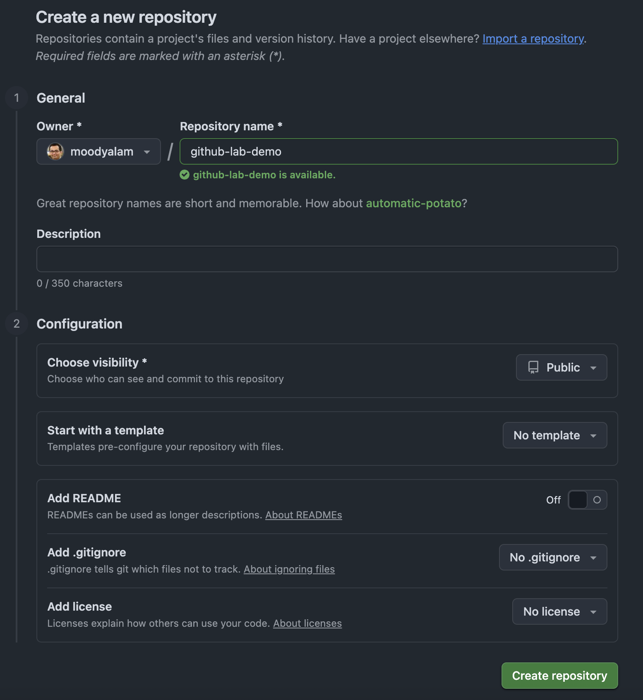

### 3.2 Adding SSH key to your account

You will now need to add an SSH key to your account so you can access your GitHub repo over Secure Shell Protocol.

Follow the instructions below as per your operating system (Windows/MacOS)

https://docs.github.com/en/authentication/connecting-to-github-with-ssh/adding-a-new-ssh-key-to-your-github-account

## 4 Setting up a Local Repository on Your Machine

1. Create a folder on your machine (e.g. `ost-demo`).
2. Using terminal (command line) browse into the folder.
3. Now run `git init` command on your terminal

```bash
git init
```

You should see an outcome similar to the image below:

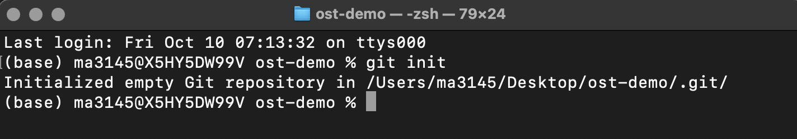

### 4.1 Creating Your First File in Local Repo

You will need to create a Python file `hello.py` in the folder. This file should have a single statement as below. You can use any text editor (or IDE like Visual Studio) to create this. Alternatively, if you are using a MacBook, you can create it using the `echo` command below.

```bash
echo "print('Hello')" > hello.py
```

File contents:

```python
print("Hello")
```

You can then save the file and run it on the command line using Python just to make sure that it prints out `Hello`.

```bash
python hello.py
```

On a MacBook the outcome will look like this:

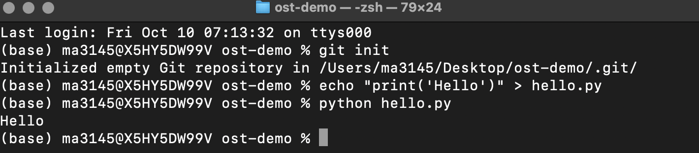

### 4.2 Committing Your `hello.py` to Your Local Repo

You can add your file with the `git add .` command and then commit it to your local repo (note this file will still remain on your machine locally and not created on remote repo yet)

```bash
git add .
git commit -m "Adding python file"
```

The outcome will look like this:

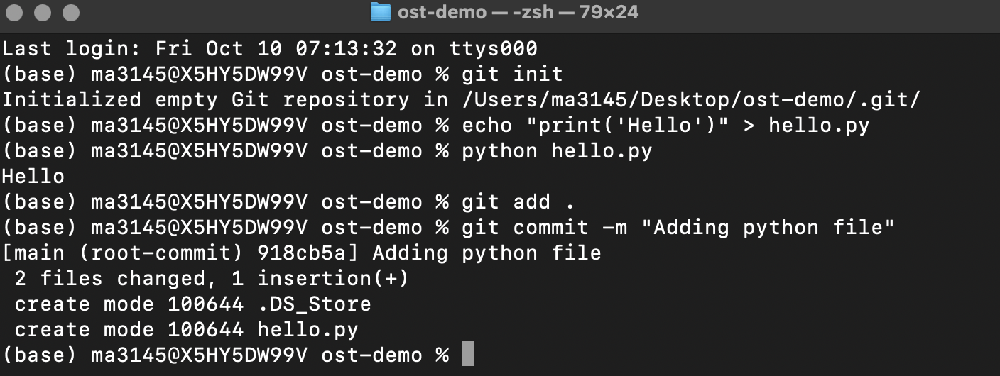

### 4.3 Linking Local Repo to Remote Repo

You can run the following command to link up your local repo (which you created when you ran the `git init` command) with your remote GitHub repo.

**Make sure to replace the `<YOUR_USER_NAME>` with your GitHub user name.**

```bash
git remote add origin git@github.com:<YOUR_USER_NAME>/github-lab-demo.git
```

This ensures that you access the remote repository via SSH keys.

**If you get stuck** with the above command (e.g., some issues with the SSH keys set-up), then use the following command instead.

```bash
git remote add origin https://github.com/<YOUR_USER_NAME>/github-lab-demo.git
```

For example, for me it is:

```bash
git remote add origin https://github.com/moodyalam/github-lab-demo.git
```

The outcome should look like this:

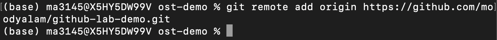

### 4.4 Pushing Your Changes to Remote Repo

By now, you have created a local repository, made changes to the local repo (i.e., creating the hello.py and adding it to the local repo), and linked up your local repo to the remote GitHub repo (with the `git remote add` command).

You now need to "push" to upload all your changes to the remote repo by running:

```bash
git push --set-upstream origin main
```

The outcome should look like this:

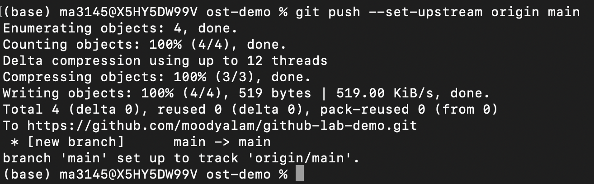

### 4.5 Confirming Your Push Has Gone Through

To confirm that your `push` command was successful you can view your remote repo online on GitHub.

The address for it should be:

**Make sure to replace the `<YOUR_USER_NAME>` with your GitHub user name.**

```
https://github.com/<YOUR_USER_NAME>/github-lab-demo
```

For example, for me it is:

```
https://github.com/moodyalam/github-lab-demo
```

And the outcome:

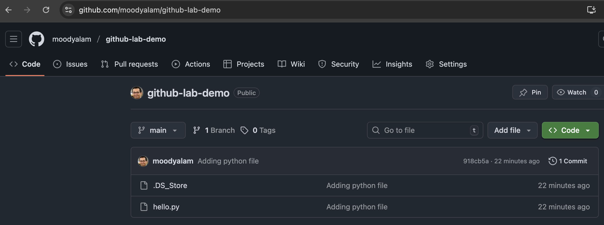

## 5 Creating a Basic CI/CD workflow script via GitHub Action

This section is focused on demonstrating a basic CI/CD workflow functionality via GitHub Action. [GitHub Actions](https://docs.github.com/en/actions) are a way to automate your workflow. Note that the primary objective is for you to understand the general concept and not to demonstrate a fully functional CI/CD workflow.

If need be, you can read up further on the links below

1. [What is CI/CD?](https://github.com/resources/articles/devops/ci-cd)
2. [Understanding GitHub Actions](https://docs.github.com/en/actions/get-started/understand-github-actions)
3. [GitHub Actions](https://docs.github.com/en/actions)

### 5.1 Creating a GitHub Action

We will now create a GitHub Action.

While staying in your folder (e.g. `ost-demo`), first create a folder hierarchy `.github/workflows`.

For example on a MacBook, you can do so by:

```bash
mkdir -p .github/workflows
```

Then browse to the `.github` folder and then to the `workflows` folder and create a `run-python.yml` file. Open that file and insert the following code and save the file. Alternatively, you can download the `run-python.yml` from the following link and then copy it into the `workflows` folder.

**[Download link for `run-python.yml` file](workflows/run-python.yml)**

`.github/workflows/run-python.yml`:

```yaml
name: Run Python Script

# When to run the workflow
on:
  push:
    branches: [ main ]

jobs:
  run-python:
    runs-on: ubuntu-latest  # GitHub-hosted Linux environment

    steps:
      # Step 1: Check out your repository files
      - name: Checkout code
        uses: actions/checkout@v4

      # Step 2: Set up Python 3
      - name: Set up Python
        uses: actions/setup-python@v5
        with:
          python-version: '3.x'

      # Step 3: Run the Python script
      - name: Run hello.py
        run: python hello.py
```

### 5.2 Push Changes to Remote Repo

To push your new changes (i.e., newly created `run-python.yml`) to your remote repo, run the following commands on your terminal.

```bash
git add .
git commit -m "Adding GitHub Python action"
git push
```

The output should look like this:

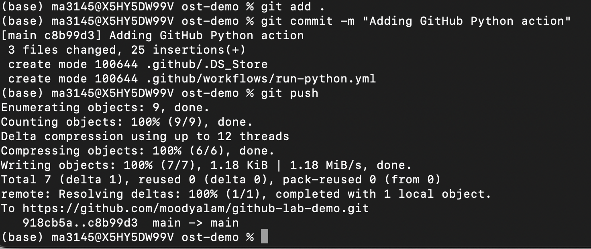

### 5.3 View Your GitHub Action

To confirm that your changes were pushed successfully, go to your remote `github-lab-demo` repo online and then click on the `Actions` tab.

The outcome should look like below. If you see the "green check" before the "Adding GitHub Python action" - then congratulations! You have just successfully created your first GitHub Action.

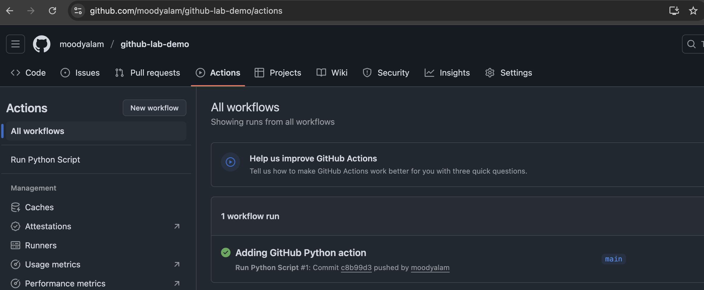

### 5.4 Explanation of Our GitHub Action

The `run-python.yml` has the code to tell GitHub that any time new changes are pushed, it should run the `hello.py` file in the repo. We already know that `hello.py` prints out a simple "Hello". To confirm that your GitHub Action did run, click on the "Adding GitHub Python action" and then on the "Run hello.py". It should show you a "Hello" as the outcome.

The outcome will look like this

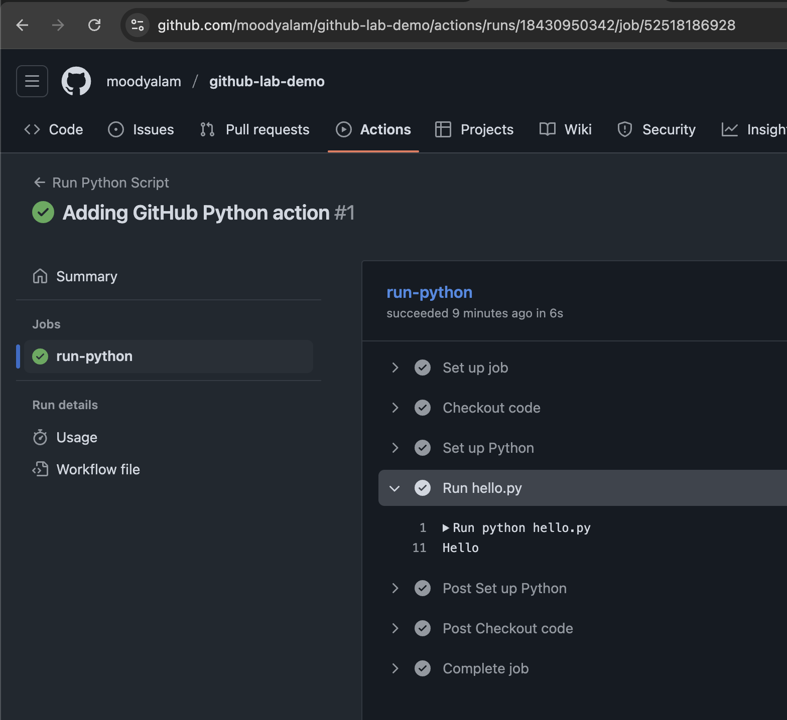

### 5.5 Running the GitHub Action Again

To see that your created GitHub Action indeed runs every time, we will now create a text file `text1.txt` in the main directory (e.g. `ost-demo`). You can use any editor (e.g. notepad) to create this file. Once you have done so, you can run the following commands on the terminal.

```bash
git add .
git commit -m "Adding text1.txt file"
git push
```

The outcome:

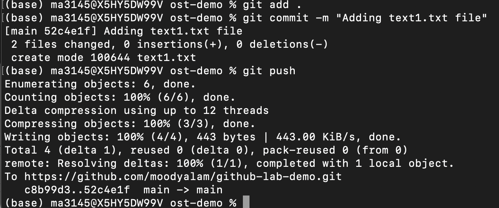

You can confirm the GitHub Action by viewing it online again.

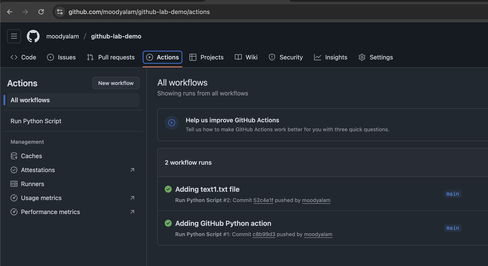

## 6 Creating "Conflicts"

Imagine that you are working as part of a data science team. A team member downloads (`pull`) your GitHub repo. They make some changes on their local repo and then `push` those changes to the GitHub repo. Now, your local copy is out of sync with the remote repo because it does not have the latest changes that your team member has pushed. This is known as a "conflict".

To simulate such a scenario, we will create a GitHub Action that will automatically create a new file and add it to the GitHub repo when new changes are pushed - thus, ensuring that your local repo is out of sync and artificially creating a "conflict". Note that this GitHub Action will **only** run if the commit message is "create conflict" (i.e., `git commit -m "create conflict"`). If the commit message is not "create conflict", it will NOT trigger the GitHub Action `conflict-bot.yml` so no conflict will be created.

### 6.1 Create a GitHub Action to Artificially Create a Conflict

To do so, we first create a GitHub Action file `conflict-bot.yml` in our `.github/workflows` directory with the following code. Alternatively, you can download the `conflict-bot.yml` and copy it into the `.github/workflows` directory

**[Download link for `conflict-bot.yml`](workflows/conflict-bot.yml)**

`.github/workflows/conflict-bot.yml`:

```yaml
name: Auto Conflict Creator

on:
  push:
    branches:
      - main

permissions:
  contents: write

jobs:
  conflict-bot:
    if: contains(github.event.head_commit.message, 'create conflict')
    runs-on: ubuntu-latest
    steps:
      - name: Checkout repository
        uses: actions/checkout@v4
        with:
          ref: main

      - name: Configure Git
        run: |
          git config user.name "Conflict Bot"
          git config user.email "conflict-bot@users.noreply.github.com"

      - name: Create conflicting file
        run: |
          FILENAME="conflict_$(date +%s).txt"
          echo "This file was automatically added by the conflict bot at $(date)." > $FILENAME
          git add $FILENAME
          git commit -m "Auto: Created $FILENAME to trigger merge conflict"
          git push origin main
```

Next, we push our changes to the GitHub repo.

```bash
git add .
git commit -m "Adding GitHub Action for Auto Conflict File creation"
git push
```

The outcome is:

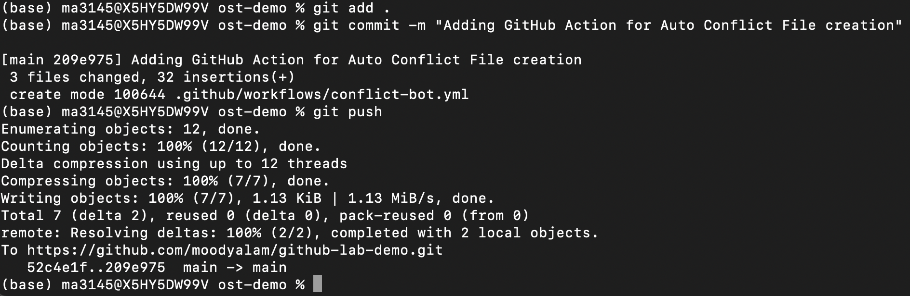

You can view it on GitHub Actions

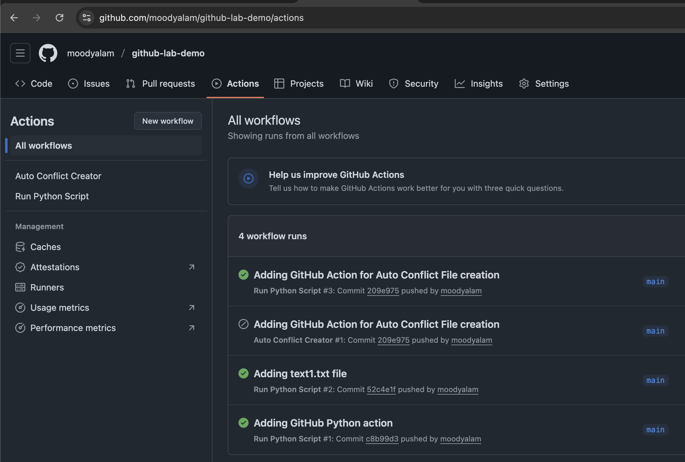

### 6.2 Testing When Our New GitHub Action Should NOT Trigger

Now, to confirm that our new GitHub Action runs **only** when the commit message is "create conflict", we will now create a text file `text2.txt` in the main directory (e.g. `ost-demo`), as we did earlier. Once you have done so, you can run the following commands on the terminal.

```bash
git add .
git commit -m "Adding text2.txt file"
git push
```

Now, you can view your remote GitHub repo which should only have 3 files `hello.py`, `text1.txt` and `text2.txt`. Our GitHub Action did not automatically add a new file to the GitHub repo, because that git commit message was **not** "create conflict"

### 6.3 Testing When Our New GitHub Action SHOULD Trigger

Now, to trigger our GitHub Action, we will create `text3.txt` in the main directory (e.g. `ost-demo`), as we did earlier, and run the following commands.

```bash
git add .
git commit -m "create conflict"
git push
```

Now, you can view your remote GitHub repo online which should have `hello.py`, `text1.txt`, `text2.txt` and `text3.txt`. However, we notice a new **`conflict_<timestamp>.txt`** file. This confirms that our GitHub Action ran and added a new file.

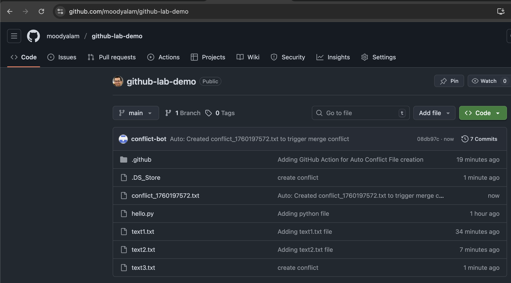

Now our local repo is out of sync as it doesn't have the `conflict_<timestamp>.txt` file.

If we try to run the `git push` command, we will get a warning to confirm that the remote repo is now different from our local repo.

```bash
git push
```

The outcome:

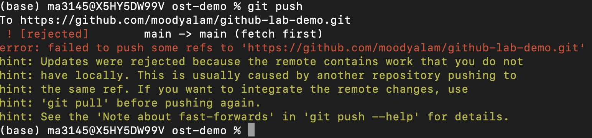

## 7 Resolving Conflicts

In this scenario, a file `conflict_<timestamp>.txt` on the GitHub repo is missing from the local repo. This is an easier conflict to resolve by doing a `git pull` which pulls (downloads) the missing file for us. Note that git also has a `git fetch` command, and the two are different:

1. `git fetch` = Downloads all new commits, branches, and tags from the remote repository — but does not modify your working files or current branch. Considered "safer" than `git pull`.
2. `git pull` = Downloads new commits and then automatically merges (or rebases) them into your current branch. Simply stated, it is somewhat equivalent to running a `git fetch` followed by `git merge`.

We will stick to `git pull` as that suffices for this demo.

```bash
git pull
```

The outcome:

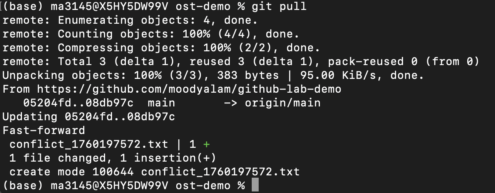

You can confirm that you have the conflict file in your folder (e.g. `ost-demo`) by browsing it or via a terminal command (e.g. `ls` or `dir`)

Now, if we run

```bash
git push
```

We will not get the warning. The command outcome should now be "Everything up-to-date"

### 7.1 Tip - Good practice

It is always a good idea to do a `git pull` before you start making changes to ensure you have a fresh local repo that is exactly the same as the remote repo!

### 7.2 Exploring a More Complex Conflict Scenario

Now suppose you started working with your local repo after running `git pull`. You create a new file and commit your change (i.e. the newly created file) to your local repo. Suppose that in the meanwhile, another team member had pushed their changes which added a new file to the GitHub repo. Now, your local repo is missing that file and when you attempt a `git push`, you'll again see a warning and your push will be rejected.

Notice that this scenario is different from the previous one.

1. In the first scenario, our local repo was missing a file from the remote repo. We did a `git pull` which got us the missing file and the conflict was resolved.
2. In this scenario, our local repo is missing a file **and** we have a new file committed to our local repo that is missing from the remote repo.

First, we start by simulating that another team member added a file to the remote repo. We follow the same steps to trigger our `conflict-bot.yml` GitHub Action.

Let's create a `text4.txt` in the main directory (e.g. `ost-demo`), as we did earlier, and then run the following commands.

```bash
git add .
git commit -m "create conflict"
git push
```

Now, view your remote GitHub repo to confirm that you have 2 conflict files (and 4 text files and 1 python file).

We now create a new `text5.txt` in the main directory (e.g. `ost-demo`) and then commit to our local repo and push the changes.

```bash
git add .
git commit -m "Adding text5.txt"
git push
```

This will give us the same warning we saw before and reject our push to the remote repo. We resolved the issue earlier with a `git pull` command. Let's try that again.

```bash
git pull
```

This will not resolve the issue! You should instead get a warning like:

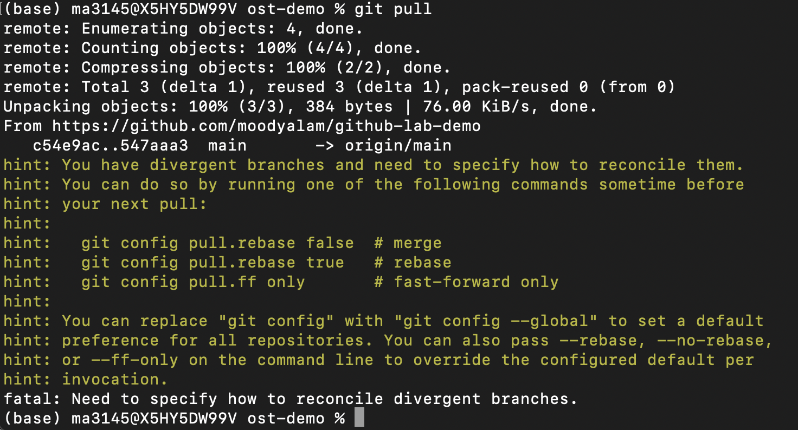

We now have **divergent branches** - i.e., it is not a simple case of either the local or remote missing some file where simply pulling/pushing will resolve the issue. Here, the remote repo has a file `conflict2_<timestamp>.txt` which is not in our local repo **as well as** a `text5.txt` file which is in our local repo but not on the remote repo!

To resolve this issue, we will use `git fetch` (which updates our local repo with the missing `conflict2_<timestamp>.txt`) and `git merge` (which merges the remote branch main - as fetched from origin - into our current local branch).

```bash
git fetch origin
git merge origin/main -m "Merging updates from remote main branch"
```

This has now resolved the issue by merging the new update from the remote repo into your local repo. Now, your local repo has the *latest version* of the code base (because you have all the changes from the remote repo, plus the new changes - the newly created `text5.txt` file - that you have in your local repo). So let's do:

```bash
git push
```

This should go through. To confirm, go and view your GitHub repo. It should have 5 text files, 1 python file and 2 conflict files (note that the most recent push didn't create a third conflict file. Why? Because the commit message was "Merging updates from remote main branch" in the `git merge origin/main -m "Merging updates from remote main branch"` command).

## 8 Creating Even More Complicated Conflicts!

So far, we have only observed conflicts arising when a file was missing from either repo. But what happens if the conflict is due to changes within a single file? For example, imagine that two members check out the same remote repo. Their local repos will be identical. However, both members start adding code to the **same** file. If one of them pushes their changes to the remote repo, the other team member won't be able to.

This is a more complex but common issue so let's see how such issues arise and are resolved.

### 8.1 Simulating Conflict Within a File Contents

To make up for the fact that there's no other team member (you must feel lonely!) working on the same remote repo, we will need to simulate that scenario. To do so, we take the same approach as we did earlier, by creating a GitHub Action that keeps adding a new line to the same `shared.txt` file, thus creating the situation where the local and remote repo will have two different versions of the same file.

To do so, we first create a GitHub Action file `conflict-bot-within-file.yml` in our `.github/workflows` directory with the following code. Alternatively, you can download the `conflict-bot-within-file.yml` and copy it into the `.github/workflows` directory

**[Download link for `conflict-bot-within-file.yml`](workflows/conflict-bot-within-file.yml)**

`.github/workflows/conflict-bot-within-file.yml`:

```yaml
name: Auto Conflict Creator

on:
  push:
    branches:
      - main

permissions:
  contents: write

jobs:
  conflict-bot:
    # Only run if the last commit message includes the exact trigger text
    if: contains(github.event.head_commit.message, 'create conflict within file')
    runs-on: ubuntu-latest

    steps:
      - name: Checkout repository
        uses: actions/checkout@v4
        with:
          ref: main

      - name: Configure Git
        run: |
          git config user.name "Conflict Bot"
          git config user.email "conflict-bot@users.noreply.github.com"

      - name: Create or update shared file to cause conflict
        run: |
          FILE="shared.txt"
          TIMESTAMP=$(date)
          echo "${TIMESTAMP}: Code Conflict" >> "$FILE"
          git add "$FILE"
          git commit -m "Auto: Conflict Bot edit at ${TIMESTAMP}"
          git push origin main
```

Note that this action will trigger when the commit message is "create conflict within file".

We now create a `shared.txt` file in the main directory (e.g. `ost-demo`) and write a single line "First line in the shared file". Then run

```bash
git add .
git commit -m "Add shared.txt"
git push
```

You can verify that the `shared.txt` file and `conflict-bot-within-file.yml` are now on your remote repo.

### 8.2 Creating a conflict within file

Now, we modify our `shared.txt` to add a second line "Second line in the shared file". We then run the following commands which commit the changes to our local repo. We then push our changes with the commit message "create conflict within file" which triggers the `conflict-bot-within-file.yml`. When `conflict-bot-within-file.yml` is triggered it will add another line to the `shared.txt` in our remote repo. Thus, the remote version of the `shared.txt` is now different from the `shared.txt` file in our local repo.

```bash
git add .
git commit -m "create conflict within file"
git push
```

You should view the `shared.txt` file on your remote repo. **Note that it will take some time for `conflict-bot-within-file.yml` to run so be patient!**

Now, we know that `shared.txt` has different versions on the local and remote repo.

We now add another line "Third line in the shared file" to `shared.txt`, and then run the following commands again.

```bash
git add .
git commit -m "create conflict within file"
git push
```

The outcome will be that our push will be rejected with a warning.

Now if you run `git pull` to resolve it, it will give you the `you have divergent branches` warning as before. Go on, try it!

```bash
git status
```

This should give you further information on the file with conflict.

Now, let's try the following command.

```bash
git pull --no-rebase
```

You're telling Git explicitly to **merge**, not rebase, the fetched commits. This should tell you that "automatic merge failed" and to manually fix the conflict.

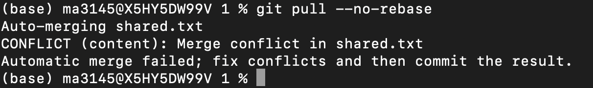

Now, open the `shared.txt` file. You will notice that git has automatically inserted a `<<<<<<< HEAD` line and a `>>>>>>> 67425485e84c55287557afad7ae97f518d5b9c2a` line. Between those two lines is the content which is different between the two versions of `shared.txt` on the remote and local repos.

To resolve it simply, delete the extra lines that git has inserted. Save the `shared.txt` file and then commit as follows.

```bash
git add shared.txt
git commit -m "Resolved merge conflict in shared.txt"
git push
```

This should go through. And we are done!

## 9 Conclusion

Well done if you got this far! You should now have an understanding of version control using git, creating and committing to local/remote repositories, creating basic CI/CD scripts and successfully executing them, exploring the basic and complex scenarios where conflicts arise between local/remote repositories and how to resolve them.
